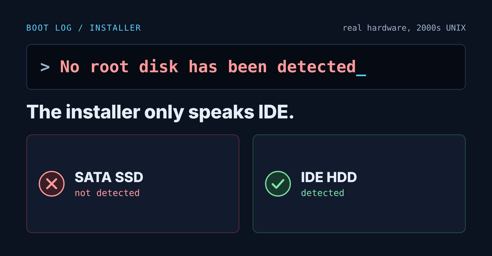
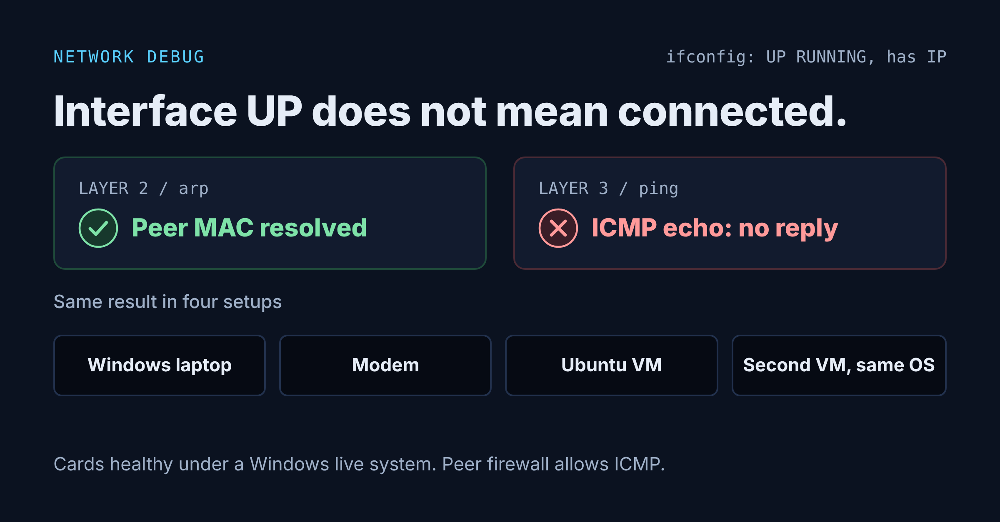

# Installing SCO OpenServer 5.0.7 on Legacy Hardware
 
> 🇮🇷 [نسخه فارسی](README.fa.md)

A hands-on lab documenting the installation of **SCO OpenServer 5.0.7** on an old desktop PC, the problems met along the way, and one problem that is still open: IP connectivity.

| Area | Status |
| :--- | :--- |
| Installation | ✅ Completed. The system boots to a shell. |
| Network card and driver | ✅ NIC detected, driver installed, interface `UP` with an IP address. |
| IP connectivity (ping) | ❌ Not solved. ARP works, but ICMP echo gets no reply. |

  
  

## Goal

Install a classic commercial UNIX on real hardware, learn how its installer and boot process work, and get the machine onto the network.

## Environment

| Item | Details |
| :--- | :--- |
| Operating system | SCO OpenServer 5.0.7 |
| Target machine | Real, older desktop PC (single-core AMD CPU) |
| Early test | A virtual machine |
| Peer systems for network tests | A Windows laptop and virtual machines |

## Installation steps

1. Downloaded the installation ISO from the vendor's site.
2. Tried to make a bootable USB stick with four different tools. The machine booted none of them.
3. Burned the ISO to a CD and booted from the optical drive. The installer started.
4. Changed the BIOS SATA mode to **IDE**.
5. Tried several boot-prompt parameters while troubleshooting disk detection.
6. Entered the license information (not documented here).
7. Chose a fresh installation with the standard desktop software set, used the quick disk surface analysis, set a root password, and let the installation run unattended.
8. The installation finished and the system reached a command line.
9. Installed the network driver, brought up the interface, and ran network tests.

## Problems and what happened

| Problem | Outcome |
| :--- | :--- |
| USB stick would not boot | Solved by using a CD. |
| `No root disk has been detected` | The SATA SSD was not detected. Switching the BIOS to IDE mode, swapping cable and port, and trying several boot strings did not help. The disk was detected when an IDE hard drive (HDD) was used. |
| Disk surface analysis extremely slow | On a large disk it ran for more than half an hour. Switching to the quick, non-destructive mode made it bearable. |
| Repeated disk timeout warnings | Appeared several times at different stages. The installation still completed. The root cause is unknown. |
| `idinstall: Cannot copy file - read/write failed` | The installer offered several options to continue. The installation still completed. |
| `Error on Fixed Disk (minor 0), blkno = 0` | The kernel could not read sector 0. After the disk and BIOS changes the installation completed. |
| Onboard NIC | Did not work easily. Details were not recorded. |
| A second PCI NIC | Did not show up in the `hwconfig` output. |
| D-Link DFE-530TX+ | Came up after installing its driver manually and got a private IP address. |
| **Ping does not reply** | **Not solved** (see below). |

## Open issue: ping

- `arp` on the SCO machine shows the MAC address of the peer, so layer 2 works.
- Ping gets no reply in four setups: directly to a Windows laptop, through a modem, to an Ubuntu VM, and to a second SCO VM.
- Several different D-Link cards gave the same result.
- The cards were confirmed healthy on the same PC by booting a Windows live system.
- ICMP was allowed in the firewall of the peer system.

The cause has not been found. It looks related to the combination of this PC and the D-Link driver on SCO.

## What we learned

- SCO OpenServer 5.0.7 had trouble with an SSD and SATA mode. IDE mode and an IDE hard drive (HDD) got the disk detected.
- Full surface analysis on a large disk is very slow. The quick option is bearable.
- "The interface came up and got an IP" is not the same as "IP connectivity works". Check layer 2 (ARP) and layer 3 (ping) separately.
- Every claim must be verified against real output from the machine. Guesses, such as confident statements about native drivers for some NICs, turned out unreliable.
- Tools and commands used: `hwconfig`, `netconfig`, `ifconfig -a`, `arp`, `custom` (for installing the driver).
- The `Boot:` prompt accepts commands such as `ls`.

## Notes

- Product keys, license details and download links for the installation media are intentionally not included. SCO OpenServer is commercial software and requires a valid license.

## Authors

Done together by:

- [Matin Ghorbani](https://github.com/AMG-ir)
- [Hesam Khavari](https://github.com/hesamkhavari)

## License

This write-up is licensed under [CC BY 4.0](LICENSE). You may share and adapt it, with credit to the authors above.
